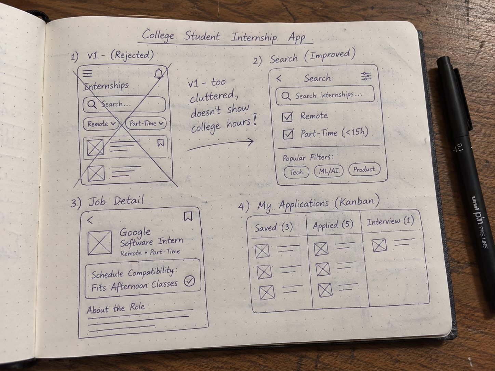

# Product Development MVP Specification & Wireframe Submission

## 1. One-Line MVP Scope Statement
> **"My MVP lets college students discover and track verified remote, part-time internships matching their class schedules so that they gain career experience without compromising their studies. It will not include employer job-posting accounts, in-app recruiter messaging, or automated video interview prep."**

---

## 2. User Journey (6 Steps)
1. **Trigger & Problem Recognition**: Tanmay, a college student with morning lectures, searches for a part-time internship in marketing and graphic design to gain real-world experience, but existing platforms only list full-time or offline positions that clash with his class schedule.
2. **Onboarding & Availability Setup**: He opens the platform, adds his core skills (Figma, Canva, Marketing), sets non-negotiable boundaries (`Remote Only`, `Max 15 hrs/week`), and marks his college class slots on a visual weekly calendar.
3. **Curated & Filtered Discovery**: The system presents a filtered feed displaying strictly part-time, remote opportunities that operate asynchronously or fit his free afternoon/weekend blocks.
4. **Schedule & Role Verification**: He clicks on a role card and reviews the **Schedule Compatibility breakdown**, which verifies that the daily workload and meeting requirements align with his free hours without unexpected in-person attendance.
5. **Tailored Application**: He uses a pre-tailored application note highlighting his portfolio and verified weekly hourly availability, and clicks **Apply**.
6. **Pipeline Tracking & Follow-up**: The application is automatically logged into his **Application Tracker (CRM)** with a status of `Applied` and a 5-day automated follow-up reminder, eliminating the silence and anxiety of ghosting.

---

## 3. Feature Brainstorm (18 Features) & MoSCoW Prioritization

### Must-Have (Core MVP — 4 Features)
| # | Feature | Description | Direct Evidence from Interview (Tanmay) |
|---|---|---|---|
| 1 | **Strict Remote & Part-Time Filter** | Hard filtering that eliminates full-time (40h/wk) and mandatory on-site roles from the feed. | *“They were full time and they expected me to work with them in offline mode and not work from home... It should be part time.”* |
| 2 | **College Schedule Matcher** | Allows students to block out lecture hours so roles requiring conflicting hours are excluded or flagged. | *“The hardest part was to find an internship role that has my interest and can go parallel with my college.”* |
| 3 | **Upfront Time-Commitment Card** | Displays weekly hours, daily time expectations, and stipend clearly on the outer card before clicking. | *“If I could wave a magic wand I would wish for our internship role that has flexible workers.”* |
| 4 | **Basic Application Tracker (CRM)** | A multi-stage pipeline tracking applications from submission through follow-up. | *“...across that whole journey from finding the role to applying to waiting for feedback...”* |

### Should-Have (v2 — 5 Features)
- **5. Automated Follow-Up Reminders**: Alerts when an application has been inactive for 5–7 days.
- **6. In-Browser Form Auto-Filler**: Extension popover that auto-fills common application questions.
- **7. AI Resume Match Score**: Percentage score (0–100%) indicating how well the candidate's portfolio matches the JD.
- **8. Minimum Stipend Filter**: Filter out unpaid internships.
- **9. Direct Email Generator**: 3-sentence outreach note tailored for direct email to founders/hiring leads.

### Could-Have (Nice Extras — 5 Features)
- **10. Telegram/WhatsApp Bot Alerts**: Push notifications when a high-match flexible role is detected.
- **11. Exam Blackout Mode**: Pauses outreach nudges during midterms and finals week.
- **12. Portfolio Preview Tile**: Embedded Behance/Dribbble/Figma preview on candidate submissions.
- **13. Drag-and-Drop Kanban Board**: Visual interactive columns (`Saved` ➔ `Applied` ➔ `Interview`).
- **14. Role-Specific Interview Prep Sheet**: 5 tailored interview questions based on the posted JD.

### Won’t-Have Now (Parked on Purpose — 4 Features)
- **15. Employer Job-Posting Portal**: Aggregating public listings first; no employer accounts in v1.
- **16. AI Mock Video Interviews**: Out of scope for early MVP validation.
- **17. In-App Direct Recruiter Chat**: Replaced with standard portal/email redirection.
- **18. Stipend & Salary Negotiation Simulator**: Unnecessary for entry-level student internships.

---

## 4. Photo of Paper Sketches

*(Original photo file available in the project folder as `photo.jpg` and `photo.heic`)*

**Sketch Iteration Notes:**
- **v1 (Discarded & Crossed Out)**: Originally designed with an overly complex search menu featuring multiple dropdowns, hiding part-time and remote settings inside nested filters. Marked with an "X" and scrapped.
- **v2 (Redrawn)**: Simplified into a clean interface with prominent toggle pills for `[Remote Only]` and `[Part-Time (<15h/wk)]`, followed by a schedule compatibility inspection panel and a 3-stage application tracker.

---

## 5. Clickable Figma Wireframe
- **Figma Prototype Link**: [https://www.figma.com/design/cUSqziKBG0hMgspxI9M1vs](https://www.figma.com/design/cUSqziKBG0hMgspxI9M1vs)
- **Screens Included**: 
  1. Student Availability & Constraint Setup
  2. Curated Match Feed with Upfront Schedule Tags
  3. Job Detail View with Compatibility Breakdown
  4. Application Tracker Kanban Board

---

## 6. Notes from 2 Wireframe Usability Checks

### User Check 1: Tanmay (Marketing & Graphic Design Student)
- **Task Assigned**: *"Find a graphic design role requiring under 15 hours a week and save it to your tracking list."*
- **Confusion Point**: The weekly hourly requirement was originally hidden inside the expanded job details panel, requiring the user to click into every card individually to check for conflicts.
- **Change Made**: Added an immediate `10–12 hrs/week · Flexible Hours` badge directly on the front-facing card in the discovery feed.

### User Check 2: Honeyvilla (Peer Student)
- **Task Assigned**: *"Click 'Apply' on a role and check where the application is stored."*
- **Confusion Point**: After hitting the 'Apply' button, the screen stayed on the job detail page without any confirmation, leaving the user uncertain whether the action succeeded.
- **Change Made**: Added an instant confirmation toast and redirected the status badge to `Applied: Follow-up in 5 days` on the Kanban board.
